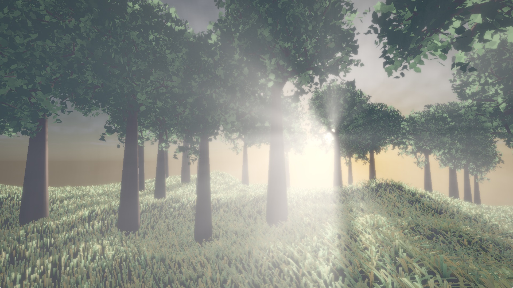
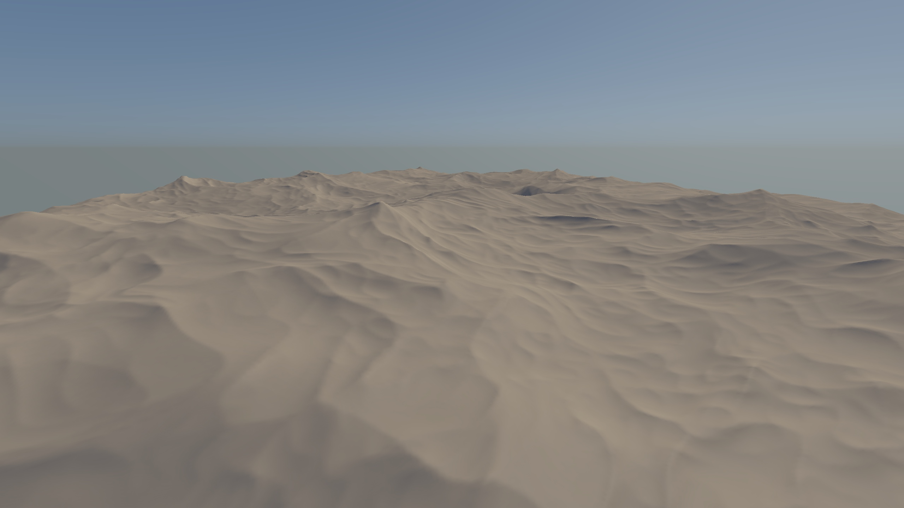
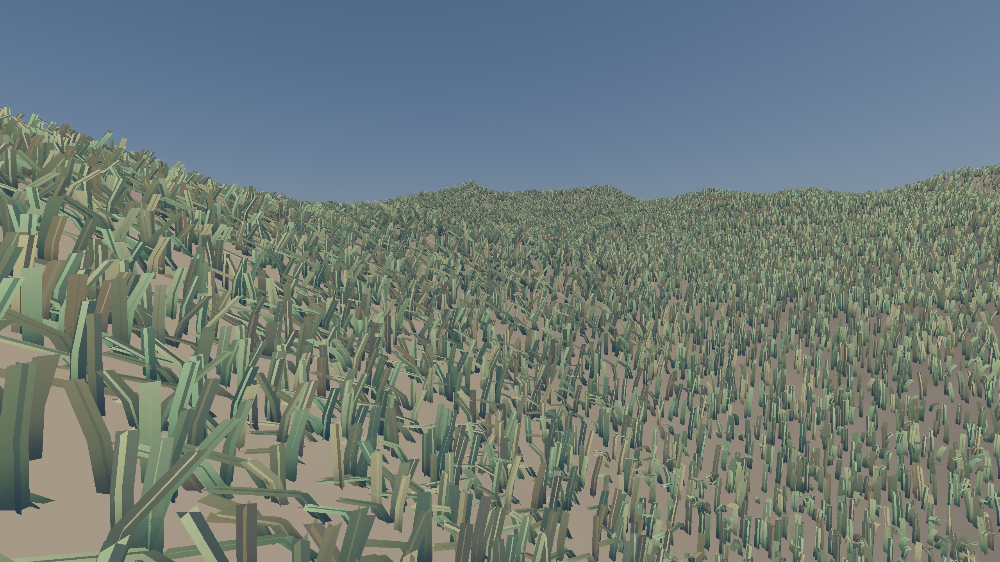
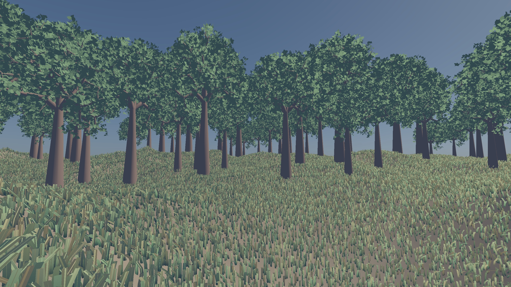
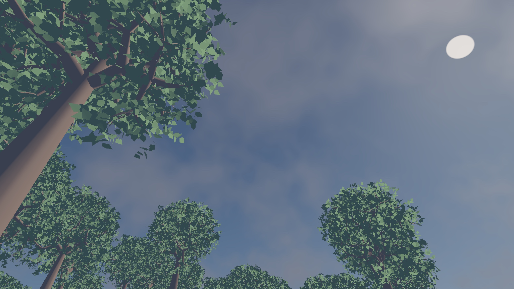
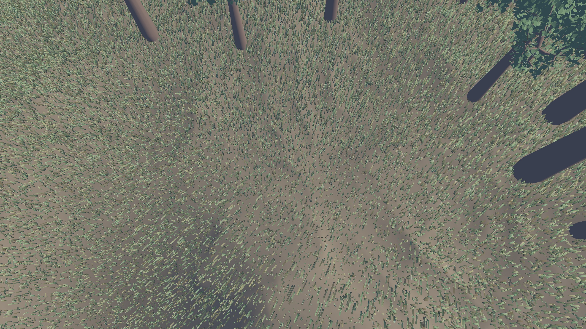
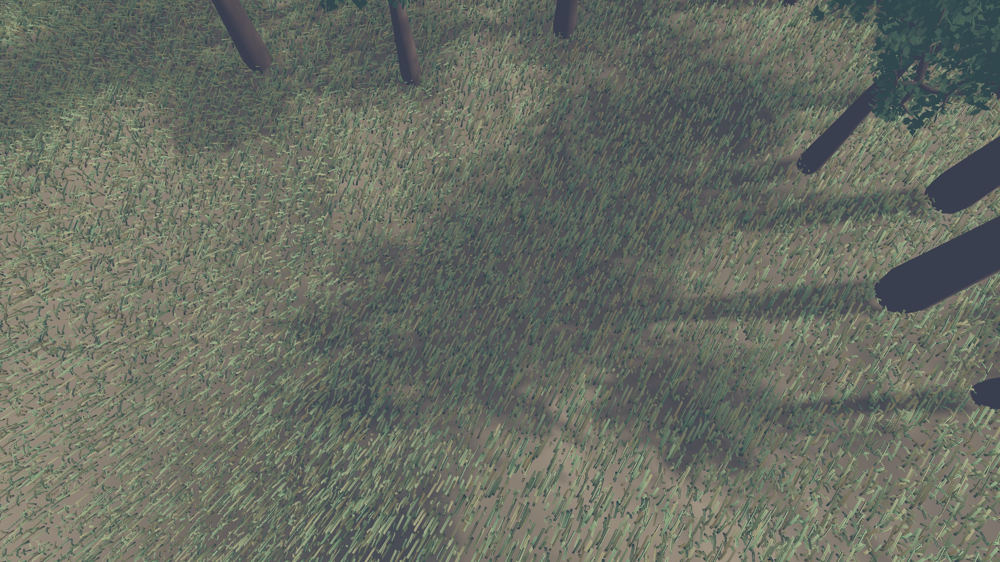
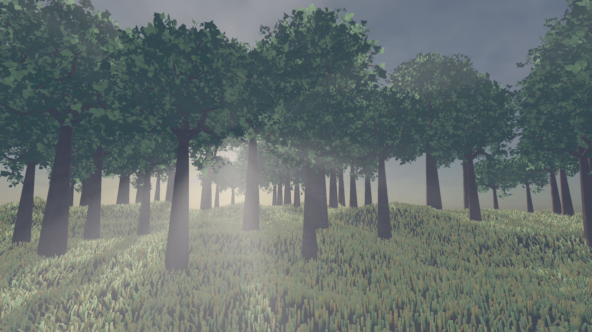

# ZeFauxRest

A real-time volumetric forest renderer written in C++17 and OpenGL 4.5 without an external rendering engine or math library. Every stage, from the procedural terrain heightmap and GPU-instanced foliage to the ray-marched clouds and volumetric light shafts, runs on the GPU through an 8-pass deferred shading and compute pipeline.


*Figure 1. Final frame rendered in real time by ZeFauxRest with GPU-instanced grass and trees, ray-marched volumetric clouds, PCF shadows, bilateral-upsampled godrays, and Hable tone mapping.*

Still frames flatten the wind ripples across the grass, the drifting clouds, and the godrays shifting as you walk through the canopy, so we encourage you to build the renderer and explore the scene firsthand.

## How it works, one pass at a time

The frame is built up from a bare procedural terrain heightmap to the final tone-mapped image by adding one rendering stage at a time (Table 1).

*Table 1. Progressive build-up of the ZeFauxRest rendering pipeline from the procedural terrain heightmap to the final HDR post-processed frame.*

| Step | What it adds | |
|------|--------------|---|
| 1. Terrain and sky | Procedural heightmap (Perlin fBm, ridged multifractal, and domain warping) generated in a compute shader and lit against an analytical Hosek-Wilkie sky in the deferred *G-buffer*. |  |
| 2. Instanced grass | Approximately one million crossed-quad grass blades instanced on the GPU, with terrain-conforming normals and desynchronized sinusoidal wind displacement. |  |
| 3. Poisson-sampled trees | Around 150 trees placed via slope-filtered Poisson disk sampling, optimized with `meshoptimizer`, and rendered instanced into the G-buffer. |  |
| 4. Volumetric clouds | Half-resolution ray-marched 3D Perlin-Worley cloud layer with Beer-Lambert extinction and a Henyey-Greenstein phase function. |  |
| 5. Unshadowed floor | Overhead view of the canopy and grass before directional shadow mapping is enabled. |  |
| 6. Shadow mapping + PCF | Directional shadow map with front-face trunk culling and *Percentage-Closer Filtering* (PCF) casting soft canopy shadows across the grass. |  |
| 7. Volumetric godrays | Half-resolution ray-marched light shafts that reuse the directional shadow map, weighted by Beer-Lambert attenuation and Henyey-Greenstein scattering, and upsampled with a depth-aware bilateral filter. |  |
| 8. HDR post-processing | Dual-Kawase bloom pyramid, Hable filmic tone mapping, color grading presets, and vignette produce the final sRGB frame. |  |

## Pipeline and features

The renderer executes an explicit `RenderGraph` each frame across compute and graphics passes, using OpenGL 4.5 Direct State Access (DSA) throughout:

- Procedural terrain heightmap and analytical normals evaluated on the GPU via compute shaders (`heightmap.comp`, `coverage.comp`), combining Perlin fBm, ridged multifractal octaves, and domain warping.
- Deferred G-buffer pass (`gbuffer_terrain`, `gbuffer_grass`, `gbuffer_tree`) storing albedo, world-space normals, and hardware depth, followed by a compute deferred lighting pass (`deferred_lighting.comp`).
- GPU-instanced vegetation with roughly one million crossed-quad grass blades animated by a shared 3D wind field and 150 Poisson-disk-sampled trees loaded via `tinyobjloader` and optimized for vertex cache locality with `meshoptimizer`.
- Directional shadow mapping with front-face culling to suppress self-shadow acne on tree trunks and 3x3 PCF filtering.
- Half-resolution volumetric passes (`clouds.comp` and `godrays.comp`) seeded with blue-noise dithering (`blue_noise.comp`) to trade banding for high-frequency noise, composited back onto the full-resolution HDR buffer through a depth-aware bilateral upsampler (`depth_downsample.comp`, `composite.frag`).
- Analytical Hosek-Wilkie sky dome (`sky.frag`) coupled to the sun elevation and turbidity controls.
- Full HDR post-processing chain (`PostFXChain`) with prefiltered mipmap bloom, Hable filmic curve (`tonemap.frag`), live color-grading presets (`ColorPresets.hh`), and vignette.

## Building and running

Requires a C++17 compiler, CMake 3.16+, GLFW 3, and an OpenGL 4.5 Core Profile driver (Linux with an NVIDIA or AMD GPU, or Mesa 4.5+).

```bash
cmake -S . -B build -DCMAKE_BUILD_TYPE=Release
cmake --build build -j
```

To launch the renderer (the `run` target automatically sets NVIDIA Prime offloading environment variables on hybrid laptops):

```bash
cmake --build build --target run
```

Or run the binary directly from the repository root:

```bash
./build/ZeFauxRest
```

To build without the Dear ImGui tuning panel:

```bash
cmake -S . -B build -DCMAKE_BUILD_TYPE=Release -DZEFAUXREST_ENABLE_UI=OFF
cmake --build build -j
```

## Controls and debug views

Every intermediate render target can be blitted to the screen at runtime using the number keys (Table 2).

*Table 2. Runtime keyboard controls and render-target debug views.*

| Key | Action |
|-----|--------|
| `W` `A` `S` `D` + Mouse | First-person fly camera |
| `Space` / `Left Shift` | Move camera up / down |
| `E` | Toggle the Dear ImGui live parameter and color-grade preset panel |
| `P` | Save the current framebuffer to `screenshot.ppm` |
| `0` | Final post-processed sRGB output |
| `1` | G-buffer albedo attachment |
| `2` | G-buffer world-space normal attachment |
| `3` | Linearized G-buffer hardware depth |
| `4` | Directional light-space shadow map |
| `5` | Deferred-lit HDR scene buffer |
| `6` | Half-resolution volumetric cloud RGBA buffer |
| `7` | Half-resolution volumetric godray RGB buffer |
| `8` | Pre-bloom HDR composite buffer |
| `Escape` | Exit |

## Project layout

```text
include/
  app/          Fly camera, Dear ImGui tuning panel, and render context
  gl/           DSA wrappers for framebuffers, meshes, shaders, and 2D/3D textures
  helpers/      Custom Vec4, Matrix4, lookAt, frustum, and orthographic projections
  render/       RenderGraph, GBuffer, shadow, sky, cloud, godray, and PostFX passes
  scene/        Procedural terrain, GPU-instanced grass, and Poisson-sampled trees
src/            C++17 implementations mirroring include/
shaders/
  passes/       GLSL 450 core vertex, fragment, and compute shaders for each pass
  shared/       3D Perlin-Worley noise, Henyey-Greenstein phase, wind, and luma helpers
  debug/        Fullscreen depth visualization shaders
assets/trees/   Tree mesh and material assets
third_party/    Vendored glad, hosek_wilkie, imgui, meshoptimizer, and tinyobjloader
docs/img/       Progressive pipeline screenshots
```

## Authors

- Abdulkadir Kessaria ([@KadirKess](https://github.com/KadirKess))
- Martin Boulanger ([@JustMart1](https://github.com/JustMart1))

## License

Released under the [MIT License](LICENSE).

Vendored third-party libraries (`glad`, `hosek_wilkie`, `imgui`, `meshoptimizer`, and `tinyobjloader`) retain their own licenses; see [THIRD_PARTY.md](THIRD_PARTY.md).
